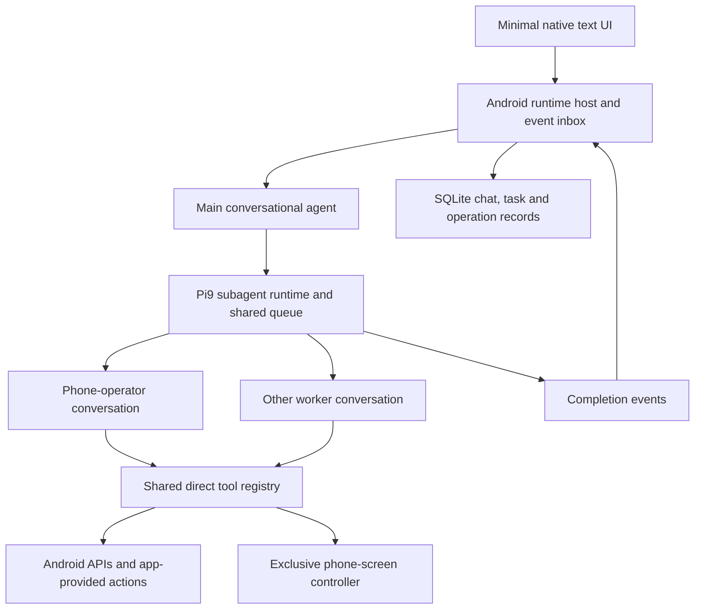

# Standalone Android agent — implementation handoff

Prepared 2026-10-15. This document is self-contained; the implementing agent does not need the preceding conversation. It describes requested work, verified source findings, design proposals and acceptance criteria. No agent app implementation or resource benchmark is claimed complete.

## 1. Product intent

Build a separate, minimal Android application with a text conversation and a background agent runtime. The main agent is the user's persistent conversational coordinator. It delegates substantial work to independently running subagents, stays available to the user, and reacts when workers finish.

For example, if a task requires a minute or two of phone navigation, the main agent creates a phone-operator worker, gives it the task and relevant context, and returns to the user. The worker performs the task, checks its outcome, and reports completion. The host delivers that result to the main agent without a loop of model calls asking whether the worker has finished.

Prioritize reliable delegation, small installed size, low incremental worker memory, responsiveness and low idle battery use. This should be a sound modular implementation rather than a quick wrapper around a complete desktop application.

### Explicit project boundary

- Create the implementation in a **new repository/project**. Choose a sensible working name; no new repository name has been fixed.
- Do **not** integrate the agent runtime into the existing Pocket MCP repository or modify that application's installation as part of this work.
- Use Pocket MCP as reference source and selectively reuse useful Android components, contracts and validation patterns. Rewrite small glue where extraction would create more coupling than it saves.
- This handoff is a plan, not a request for the preparing agent to create that new repository now. The implementing agent should begin the implementation in its own work session.

## 2. Decisions already made by the user

| Area | Decision |
| --- | --- |
| Deployment | Standalone Android APK; the core app works without a desktop companion, Termux, proot or a remote agent-host server. Cloud model APIs are expected. |
| Harness | Pi, with **`@pi9/subagent`** for the first iteration. Package adaptations for mobile and resource reduction are allowed. |
| Main agent | Conversation, delegation, steering and result synthesis. Substantial phone/computer-use workflows belong to workers. |
| Subagents | Background execution, synchronization, contextual follow-up, inspection, steering, cancellation, recursive delegation and configurable tool access. |
| User interface | Minimal native text chat, send/stop, status and temporary child-conversation views. Voice comes later. |
| Internal tools | Typed direct tools calling native Android functions, including bounded batching. No HTTP/MCP loopback is required for the agent to use its own phone. |
| Model connections | Retain both API-key and Codex/ChatGPT-account connection requirements from prior planning. Verify the actual supported mobile authentication route; do not invent one. |
| Resources | Share one agent runtime and common services. Reduce per-worker initialization, retained context and unnecessary code/features. |
| Build and validation | APK compilation/signing on **GitHub Actions**. Runtime/emulator validation on the user's **local Fedora machine**, outside GitHub Actions. |
| Later features | Voice STT/TTS, advanced external memory, additional MCP connections and richer displays. Keep clear integration boundaries. |

The previously discussed `pi-durable` alternative and a different tmux-based Pi subagent extension are **not** the selected initial implementation.

## 3. Main-agent behavior contract

1. Respond conversationally and dispatch work promptly. Judge task complexity before beginning a long tool sequence; do not first spend a minute attempting the task in main.
2. Delegate multi-step phone navigation, screenshot-driven work and other substantial tasks. The user's one-to-two-minute example describes the kind of work, not a timer that must expire before delegation.
3. Main may perform a trivial lookup or genuinely short single action when dispatch would add unnecessary overhead. It must not become the default phone operator.
4. Give workers a concise assignment, relevant facts, tool grant, desired outcome and verification criteria. Do not copy all of main's transcript into every new worker.
5. After asynchronous dispatch, end main's current model run normally. Continue accepting the user's messages while the worker is active.
6. Completion is delivered by a host event. If main is idle, schedule a new turn. If it is responding, enqueue/coalesce the result for the appropriate boundary. Serialize all turns for the same conversation.
7. Main summarizes verified results and handles ambiguity, failure or follow-up. Do not automatically launch an extra reviewer model for every trivial success.
8. The user can inspect a worker, talk to it, steer it or cancel it. Preserve that worker's conversation when useful for follow-up.
9. Main should not normally issue a blocking `join` on unfinished work. Retain `join` for explicit collection and legitimate worker dependencies. After a completion event, result collection can happen without holding main waiting for the job.
10. Distinguish the user's Stop-current-response action from Cancel-worker and Stop-all-work. Stopping main must not accidentally cancel every background worker.

### Example acceptance trace

```text
User -> Main: Do a multi-step task in the phone fixture app.
Main -> subagent: spawn phone-operator with task + outcome criteria.
Host -> UI: task queued/running; main's response completes.
User -> Main: What is happening? / a second unrelated question.
Main -> User: Responds while the phone-operator continues.
Worker -> Native tools: observe, act, verify, possibly direct API actions.
Worker -> Host: terminal result with evidence and any uncertain outcome.
Host -> Main inbox: completion identified by worker ID + generation.
Main -> User: Concise outcome; worker can be resumed for follow-up.
```

## 4. Verified source baseline

### Existing Android reference

Public repository: [ru-aish/pocket-mcp](https://github.com/ru-aish/pocket-mcp). Public visibility was verified on 2026-10-15.

At inspection:

- `main`: `a27427d880154a5f68811e405e34b425dabb856f`.
- `fix/ngrok-connection`: `777add9fdf6193dd94ec9541d0278405dc0761f5`.
- `feature/agent-runtime`: `b41f84d122354c561bf5e813d641cb820be513a4`, earlier design material, not a completed in-app agent.
- Published release observed: `v0.1.0`. Do not infer that an APK is published or validated merely because an edited README names a newer release.

Recheck remote state before reuse. The local Pocket MCP checkout also has pending documentation/test-runner edits: do not reset, overwrite, merge or publish them as part of the new project.

| Reference path | Useful material | Extraction boundary |
| --- | --- | --- |
| `control-core/src/main/java/dev/pocket/control/ControlBackend.java` | Observation/action/result contract, semantic selectors, snapshot and display dimensions | Independent of MCP and the model; a useful starting point. |
| `android-platform/src/main/java/dev/pocket/android/` | Android screen, system, messaging, notification and media adapters | Reuse the narrow native functions after inspection. Permissions and lifecycle must belong to the new app. |
| `app/src/main/java/dev/pocket/mcp/PhoneTools.java` | Existing dispatch behavior, validation and capability discovery | Currently couples dispatch to MCP result formatting and some tunnel status. Extract useful logic behind a direct typed registry. |
| `app/src/main/java/dev/pocket/mcp/OperationStore.java` and `SmsReceiptReceiver.java` | Persistent mutation IDs, deduplication, receipts and unknown-outcome handling | Preserve behavior while removing accidental old-app dependencies. |
| `app/src/main/assets/tools.json` and `contracts/backend-v1.json` | Existing tool and backend contracts | Reference schemas; do not require MCP envelopes internally. |
| `fixture/`, `scripts/emulator_test.py`, `scripts/start_fedora_emulator.py` | Synthetic app and actual-outcome/lifecycle validation patterns | Adapt to direct calls and the new app ID. Do not claim old test passes validate the new runtime. |
| `.github/workflows/apk.yml` | Signed artifact/build provenance pattern | Create a workflow for the new app; use its own credentials and signing configuration. |

Do not copy the entire old application, tunnel stack, diagnostics artifacts, credentials, signing material or desktop transports into the new runtime. Preserve relevant upstream notices for reused components.

### Selected subagent package

- Package: [@pi9/subagent](https://pi.dev/packages/@pi9/subagent), inspected manifest version **0.12.0**.
- Source: [Chase-C/pi9](https://github.com/Chase-C/pi9), inspected commit **`94405f79bb1e400fcba5e1b973778ef82d8378b2`**.
- Pi inspected separately: [earendil-works/pi](https://github.com/earendil-works/pi), commit **`dc939913f6142adce7c09da5707fdd6451b37fb0`**, package manifests 1.2.0.

Important findings from the package source:

- [scheduler.ts](https://github.com/Chase-C/pi9/blob/94405f79bb1e400fcba5e1b973778ef82d8378b2/packages/subagent/src/scheduler.ts): shared **in-process** execution queue; no tmux or process per child. It can release a capacity lease while waiting for descendant work.
- [execute.ts](https://github.com/Chase-C/pi9/blob/94405f79bb1e400fcba5e1b973778ef82d8378b2/packages/subagent/src/execute.ts): creates coding-agent SDK sessions; defaults to **`SessionManager.inMemory`**; reloads resources and discovers inherited extensions. These are concrete adaptation points.
- [runtime.ts](https://github.com/Chase-C/pi9/blob/94405f79bb1e400fcba5e1b973778ef82d8378b2/packages/subagent/src/runtime.ts): retains conversations in process, manages ownership, state, collection and capacity.
- [notifications.ts](https://github.com/Chase-C/pi9/blob/94405f79bb1e400fcba5e1b973778ef82d8378b2/packages/subagent/src/notifications.ts): can trigger main when model-initiated workers finish. User-initiated work has different subscription behavior. It uses some deferred timers; do not describe the package as timer-free.
- [index.ts](https://github.com/Chase-C/pi9/blob/94405f79bb1e400fcba5e1b973778ef82d8378b2/packages/subagent/src/index.ts): imports terminal UI and appends completed-generation metadata; that metadata is not a durable checkpoint of running child conversations.
- [package.json](https://github.com/Chase-C/pi9/blob/94405f79bb1e400fcba5e1b973778ef82d8378b2/packages/subagent/package.json): peers include Pi AI, coding-agent, TUI and TypeBox. Its development setup references Pi 0.82.1. Wildcard peer ranges do not prove compatibility with current Pi 1.2.0.

Pin a demonstrated compatible Pi/package combination. This extension is not a drop-in for bare `pi-agent-core` or `pi-durable`; a different execution backend requires adaptation. Its advertised package size is not the whole runtime's APK size or RAM.

## 5. Architecture



### Host

One Android application-owned JavaScript runtime hosts main and logical worker sessions. A single separate runtime process is acceptable if required by the embedding technology; a separate engine/process per agent is not the target design. Keep execution independent of Activity creation/destruction.

**First engineering gate:** demonstrate a maintained Android embedding compatible with the selected Pi backend, streaming Fetch, cancellation, required crypto/auth APIs and storage. Pi currently targets modern Node APIs. Do not assume Hermes, QuickJS, Bun, a WebView or an old Android Node embedding can run it unchanged. If full Node is necessary initially, measure its footprint honestly and isolate it behind the host interface. Do not silently substitute a desktop companion.

### Direct tools

- One application-owned registry defines tool names, schemas, handlers, permissions, output bounds and read/mutation metadata.
- Pi tools call a narrow native bridge into the existing Android action layer. Main and every worker receive appropriate views of the same registry.
- The stock Pi9 executor explicitly supplies the recursive child tool; main-only custom tool registration is not sufficient evidence that children can use Android tools. Modify the executor or supply an explicit allowlisted extension to wire them consistently.
- Prefer direct Android APIs, then app-provided actions, then semantic accessibility, then screenshot/gesture fallback.
- Phone computer use means the worker's model uses screenshots/accessibility and native input tools. Codex desktop's built-in computer-use capability is not an embeddable component established by this plan.
- Keep capability discovery and explicit permission/availability failures. A model connection cannot manufacture Android privileges or missing third-party APIs.

### Screen ownership

One phone has one shared interactive screen. A worker acquires a screen lease for an observation/action sequence and releases it at meaningful boundaries. Serialize competing UI mutations; concurrent API-only workers remain possible.

Lease acquisition and release must be bounded and cancellation-aware. Re-observe on handoff, after user interaction, and after a window/layout change. Do not queue a long list of coordinates from an old screenshot.

### Batching

Provide a bounded direct batch tool. Independent reads may run concurrently; screen mutations are ordered. Preserve per-operation IDs, results and errors. Validate the batch before dispatch and stop dependent steps when prerequisites fail. Mutating batches are not atomic transactions and must not be blindly replayed after a partial failure. Re-observe between state-changing screen steps when necessary.

### Notifications and conversation synchronization

Key execution and completion by worker ID and generation. Preserve Pi9's user/model collection receipts and resume eligibility. A notification, inspection and result collection are different operations; replacing the terminal overlay must not collapse them accidentally.

Deliver model-initiated worker completions to main with no model polling. Document the Android UI's behavior for user-initiated worker generations and direct worker conversations. Completion is persisted before presentation, deduplicated, and acknowledged through the appropriate collection path. If multiple workers finish together, coalesce delivery where that preserves task semantics. Avoid repeated main wakeups for the same generation.

## 6. Resource reduction plan

The selected Pi9 package already uses in-process sessions. Compare improvements against **that** implementation, not the unrelated tmux extension.

| Reduction | Implementation direction |
| --- | --- |
| Repeated child startup work | Share model/auth services and tool definitions; cache app-owned agent definitions/settings; avoid per-child directory scans and inherited extension discovery. |
| Desktop presentation | Separate Pi9 runtime/scheduler/contracts from commands, widgets, overlays and tool renderers. A new mobile entry point is acceptable; keep semantic behavior. |
| Large context per worker | Fresh concise assignments; relevant references rather than full main-transcript forks. Load saved child history only when needed. |
| Idle retained conversations | Save reusable context, release live sessions/resources when safe, and restore for follow-up. Add an adapter rather than pretending stock in-memory sessions already do this. |
| Redundant connections | App-managed shared MCP/provider services where appropriate; distinct per-conversation request/session identity and cancellation. |
| Provider dependencies | Include selected adapters and required auth modules. Avoid all-provider/compat imports. Verify emitted bundles rather than copying the full npm tree. |
| Images | Keep vision input; prepare bounded screenshots with Android APIs. Do not retain screenshot histories by default or bundle duplicate WASM image processors unnecessarily. |
| Optional features | Exclude voice, local models, local embeddings, code-mode VM, desktop coding tools, rich export/rendering, hot reload and package manager from the base build unless genuinely required by the selected backend. |
| Progress/storage churn | Coalesce progress updates; keep final results and operation records reliable. Dispose UI watches when views close. |

Never remove schema validation, cancellation, retry classification, bounded outputs, credentials protection, result collection or operation deduplication merely to reduce code size.

### Proposed starting limits — tunable, not measured guarantees

- Two concurrently executing child agents across the recursive tree, package setting `runtime.maxConcurrentSubagents`.
- Four task entries per spawn call, package setting `runtime.maxTasksPerCall`.
- Twelve retained child conversations initially, package setting `runtime.maxConversations`; reject or offer explicit cleanup at capacity, never silently discard uncollected work.
- Preserve recursive delegation under the shared cap. Add host depth/task/token limits where needed; do not invent nonexistent package configuration keys.
- Reserve main-agent responsiveness independently of child capacity. Waiting on descendants must not cause queue deadlock.
- `widgetPlacement: "off"`; `runtime.completionNotify: "auto"` initially.

Exact MB, spawn milliseconds, battery percentage and percentage savings are **unknown** until measured. Establish targets after the first embedding/baseline measurement; do not manufacture numbers from source size or an npm package listing.

## 7. Background lifecycle and persistence

“Always on” means a user-started background host that remains ready without continuous inference. Use an appropriate Android service/lifecycle design with visible status and a Stop action. No busy loop, regular model-status checks, permanent microphone or unconditional indefinite wake lock.

Android can restrict networking and terminate processes, including during inactivity. Explain and validate actual behavior; do not promise immortal execution. See [Android Doze guidance](https://developer.android.com/training/monitoring-device-state/doze-standby).

Persist at least:

- Main transcript and worker identities/generations/statuses.
- Worker task, tool grant and context needed for a truthful follow-up/recovery path.
- Pending completion delivery and collection acknowledgements.
- Mutation operation IDs, fingerprints, receipts and uncertain outcomes.
- Credential references; actual secrets belong in platform-protected storage.

For the first usable release, a process-killed worker may become explicitly `interrupted` with saved context and an offered restart/resume. Full mid-step durable continuation can be a later package adaptation. Do not claim automatic child recovery from Pi9's existing `SessionManager.inMemory`, and do not lose an interrupted task silently.

After process death, inspect the owning app/provider before repeating a side effect whose outcome is unknown. Keep `requested`, `dispatched`, `verified`, `failed` and `unknown` distinct. A completed gesture does not prove a message was delivered, and an off-hook call state does not prove connection.

## 8. Minimal UI

One primary text conversation, compact runtime status, text input, Send and Stop-current-response. A small task list shows queued/running/completed/failed/interrupted children. A child view supports text follow-up, steering and cancellation; plain text and simple structured outcome rows are sufficient.

Closing a child view must not kill its job. Removing temporary thread UI later must not require rewriting the scheduler. Persist execution identity separately from UI navigation. Permission setup and unavailable capabilities should be actionable and understandable.

No voice, rich renderer, terminal emulator, large dashboard, local model download, autonomous memory service or extra package marketplace in this iteration. Build interfaces for future voice/memory/MCP modules without implementing their full stacks now.

## 9. Existing public MCP requirement

The existing Pocket MCP app remains a separate project and provides its current external control surface. The new agent calls native tools directly.

Preserve a future adapter boundary so the same new registry can be exported through MCP if required. This handoff does not revoke the earlier public-URL/ChatGPT-connector goal, but it is not a prerequisite for first demonstrating the independent minimal on-phone agent. Do not port ngrok and HTTP machinery into every worker or require a tunnel for local chat/control.

## 10. Implementation sequence and exit criteria

| Stage | Deliverable | Exit criterion |
| --- | --- | --- |
| 0. Bootstrap and compatibility | New repo, dependency/source pins, Android runtime decision record, minimal Actions build | Real ARM64 embedding runs a scripted/fake model tool loop; streaming and cancellation work. Record footprint and compatibility gaps. |
| 1. Headless Pi9 integration | Main session, subagent runtime, mobile entry point, controlled tool registry | Fake-model workers spawn, steer, finish, collect and resume. Completion wakes idle main once; new user input works during child execution. |
| 2. Direct Android tools | Native bridge, selected controls, mutation ledger, batching, screen lease | Fixture postconditions pass for real native operations; both main and child can use granted tools; conflicting workers cannot corrupt the shared display. |
| 3. Minimal product shell | Native text UI, runtime service, basic persistence, permission setup | Background job survives Activity recreation; process termination produces honest recovery/interruption state; user can stop main, one worker or all work distinctly. |
| 4. Model connections | Supported API-key and account-login paths through isolated adapters | Authenticate and execute a harmless real tool request on the phone; disclose any account-path blocker without silently dropping that requirement. |
| 5. Resource reduction and release | Dependency/bundle report, measured baseline comparison, signed release APKs and validation report | Demonstrate actual reductions, no unbounded growth, responsive main and verified outcomes on the exact distributed build. |

Build APKs only in GitHub Actions. Run emulator/device runtime validation locally on Fedora. Use direct Codex terminal access as previously requested, not a Fedora MCP connector. ADB can provision/read the local emulator; task execution should use the new direct tools, so tests do not bypass the feature being validated.

Use exact emulator serials, prefer the existing emulator fixture, and never silently select the connected physical phone. Preserve the user's active desktop/network and unrelated processes. No real carrier call/SMS or unrelated third-party messages are needed to validate the architecture.

### Functional acceptance scenarios

1. A long fake-model/fixture job is delegated; main answers a second user message before that worker finishes.
2. Worker completion schedules main exactly once per generation, including when main was idle; concurrent completions and app restart do not duplicate delivery.
3. Direct child conversation, steer, cancel, collection and resume preserve the correct worker identity and receipt semantics.
4. Nested workers share concurrency limits and complete under a low-capacity queue without deadlock.
5. Two screen workers serialize operations, refresh observations on handoff and release ownership after cancellation/failure.
6. A batch that partially executes and loses its response does not duplicate mutations on retry.
7. Closing/reopening UI leaves active work under service ownership. Process kill makes unresolved outcomes explicit and preserves saved results/task records.
8. Missing permission, lock/sleep, stale screen context and unavailable provider produce structured failures, not invented success.
9. Shipped APK contains selected dependencies/assets; disabled terminal features are not counted as removed unless the bytes are actually absent.

### Resource acceptance evidence

Compare the adapted runtime against stock headless Pi + this same Pi9 package using compatible versions, the same engine/ABI, fixed context sizes and a scripted model. Separate host spawning time from remote model/network latency.

Report compressed APK size, installed bytes, idle RSS/PSS and JS heap where available, incremental queued/running/retained-worker memory, spawn p50/p95, memory after repeated spawn/finish/remove cycles, idle CPU/wakeups/network, main response latency under worker load, and a physical-phone battery/background observation. Emulator tests cannot establish real-phone battery use.

Avoid repeated initialization, per-agent engine heaps, silent history loss and monotonically growing retained sessions. If a proposed optimization fails to improve a measured dimension, report that rather than counting disabled settings as a performance gain.

## 11. Required implementation handoff back to the owner

- New repository URL and exact source/dependency pins.
- Architecture/runtime choice and any necessary Pi9 modifications, with upstream notices retained.
- Signed ARM64 APK download, emulator-compatible artifact, hashes and build provenance from Actions.
- Validation report tied to those exact artifacts; measured resources and remaining limitations.
- A brief list of unfinished account login, Android background/OEM behavior or persistence gaps. Do not call the app stable from compilation alone.

## 12. First action for the implementing agent

Start with the runtime/package compatibility gate and a separate new repository. Keep the user updated with concrete findings. Preserve the selected Pi9 package behavior while removing presentation/discovery overhead; do not replace the chosen harness or expand the first release into voice, a memory platform or an all-purpose desktop environment.

The central success criterion is: **the user can keep talking to main while a lightweight worker independently completes real phone work, and main receives a truthful result without polling.**
